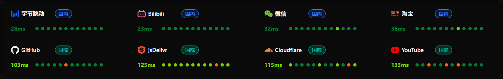

https://raw.githubusercontent.com/cc1nt/ip/main/tw1.txt
## 1.通过fofa搜索ip

## 2.筛选可用的ip

## 3.导入客户端，挑选低延迟的ip 做为 proxyip 与 优先ip

## 4.测试各类网站连通性

## 优选IP，是用来从本地连接到worker， 例如 162.159.38.125#东京
本机 → CF 边缘（入口），只能从 CF 官方 IP（AS13335）里选，优化目标入口延迟低、不绕路
## proxyip，从worker 连接到 访问的网址，例如youtube
出口能连通、地区对、风控好

# jp1
    2026年10月28日21:16:18 日本原生运营商
    60.130.209.253

