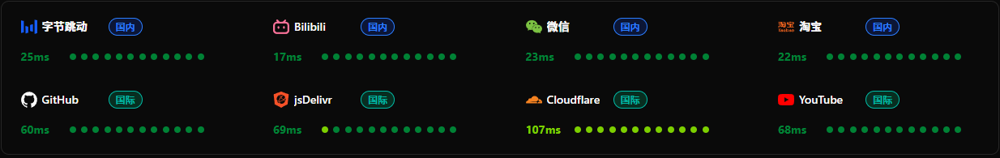

# **两种IP的区别**
## 入口IP，从本地连接到cf worker
    本机 → CF 边缘（入口），优化目标入口延迟低、不绕路，可以用优选域名保底
## proxyip，从worker连接到访问的网址，例如youtube 币安
    出口能连通、地区对、风控好。所谓优选IP，基本指这个，这个最重要
# ProxyIP来源：fofa+中转发布+博主域名解析
## fofa搜 原生运营商 jp1
    来自日本原生运营商，IP稀少，一个月只有三四个
## **CF中转IP发布** jp 	🔥
    来自CF中转IP发布，这里的IP非常多，而且基本有效，挑选其中延时低的
    https://zip.cm.edu.kg   
    https://zip.cm.edu.kg/all.txt   
    最推荐这个，基本覆盖了fofa的搜索结果 ✅ 
    拿到文件后，直接使用，无须自行测试连通性，用AI筛选下风控低的，导入客户端，在客户端里找延时低的    
## ProxyIP.JP.CMLiussss.net
    从各大博主分享的ProxyIP网址解析出来
# 操作流程
 - 1.通过fofa搜索ip,推荐当地本土原生运营商，不要用国际大厂    
 - 2.筛选可用的ip：ProxyIP.JP.CMLiussss.net，https://check.proxyip.cmliussss.net/     
 - 3.导入客户端，挑选低延迟的ip，做为 proxyip 与 优先ip，两个设置成一样的     
 - 4.测试网站连通性与延迟     
https://bestcf.pages.dev/tiancheng/all.txt?port=443    
https://bestcf.pages.dev/wetest/ipv4.txt   
https://bestcf.pages.dev/lzj/all.txt   
https://raw.githubusercontent.com/cc1nt/ip/main/jp2.txt#jp2    
# **中低风控ASN**
- 17676|2516|4713|9605|2914|2497|2518|2514|4685|138384|37903|2527|17511|7679|10010|18126|9824|9617|4721|4725|10013|9595|2510    
- country="JP" && server="cloudflare" && port="443" && status_code="403" && (asn="2914"||asn="4713"||asn="2516"||asn="17676"||asn="2497"||asn="2518"||asn="2514"||asn="4685"||asn="9605") && is_honeypot=false
## 🟢 第一梯队：真·低风控（原生运营商/移动，优先保留）,11个
    17676|2516|4713|9605|2914|2497|2518|2514|4685|138384|37903  
    SoftBank / KDDI / NTT-OCN / Docomo / NTT骨干 / IIJ / BIGLOBE / NTTPC / ASAHI / 乐天 / Ymobile   
## 🟡 第二梯队：中低风控（区域宽带/有线电视宽带，可用但次优），12个
    2527|17511|7679|10010|18126|9824|9617|4721|4725|10013|9595|2510     
    So-net / OPTAGE / QTnet / TOKAI / Chubu / JCOM / ZAQ / ODN / FreeBit / NTT-ME / INFOWEB     
# 更新
2026年10月29日11:46:25  新增jp0,从池子里筛选风控度低的IP    
https://raw.githubusercontent.com/cc1nt/ip/main/jp/2053.txt:2053    
https://raw.githubusercontent.com/cc1nt/ip/main/jp/2083.txt:2083    
https://raw.githubusercontent.com/cc1nt/ip/main/jp/2087.txt:2087    
https://raw.githubusercontent.com/cc1nt/ip/main/jp/2096.txt:2096    
https://raw.githubusercontent.com/cc1nt/ip/main/jp/8443.txt:8443    

